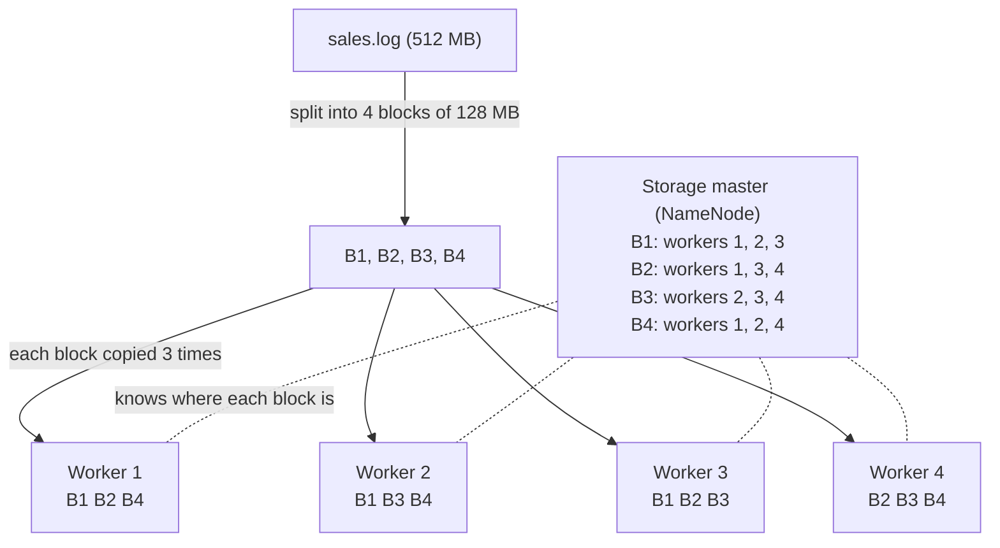
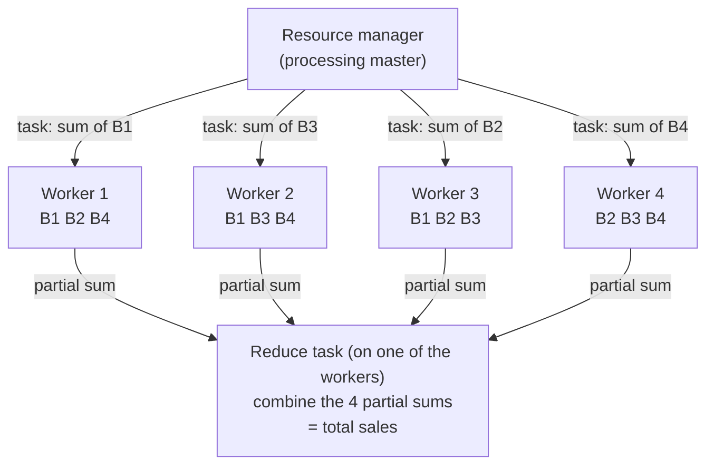
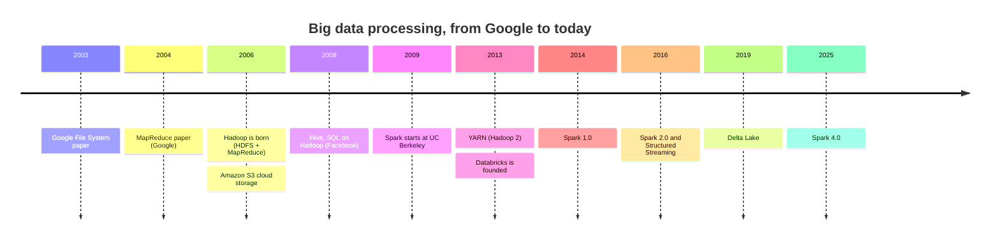

# Big Data Technologies: Spark, Hadoop, MapReduce

In this lesson, we’ll dive into the world of Big Data technologies, focusing on three powerful tools: **Hadoop**, **MapReduce**, and **Apache Spark**. Each of these technologies plays a crucial role in handling large-scale data processing across distributed systems.

---

## Hadoop and Its Ecosystem

**Hadoop** is an open-source framework designed for the distributed storage and processing of large datasets across clusters of computers. Hadoop is highly scalable and fault-tolerant, making it a backbone technology for Big Data solutions.

### How a Cluster Works

A **cluster** is a group of ordinary computers (called **nodes**) connected by a network, that work together as if they were one big computer. There are two roles:

- **Master node**: the coordinator. It does not store the data itself, it knows *where* the data is and decides *who* does what.
- **Worker nodes**: they store the data and do the actual work. A cluster can have from a few to thousands of workers.

#### Storing a file: split and copy
Imagine a 512 MB file of sales, `sales.log`. Instead of saving it on one machine, the cluster:

1. **Splits** it into blocks of the same size (in Hadoop, 128 MB by default): here 4 blocks, B1 to B4.
2. **Copies** every block on 3 different workers (this is called **replication**).
3. **Remembers** on the master which block is on which worker.



Why copy every block 3 times? Because with many machines, **something always breaks**. If worker 2 stops working, every one of its blocks still exists on two other workers, and the master simply creates a new copy somewhere else. Nobody loses data, and nobody has to stop.

#### Processing a file: send the code to the data
The data traveled over the network only **once**, when the file was stored. Big data is usually written once and read many times, so the cluster avoids moving it again for every job.

To process `sales.log` (for example, to compute the total sales), it would be slow to send 512 MB over the network to one machine. The cluster does the opposite: it sends the **program**, which is small, to the workers that already hold the blocks.

- Each worker processes **its own block**, at the same time as the others: 4 blocks means 4 tasks running in parallel.
- A **resource manager** decides which worker runs which task, choosing a worker that has a copy of the block, and starts the task again on another worker if one fails. It is another master role, separate from the storage master (in real clusters it often runs on its own machine).
- At the end, the partial results are sent over the network to a worker that combines them into the final result (a **reduce task**). The master is not involved: it only hands out the tasks. How exactly the results are combined is what **MapReduce** describes (see below).



With 1,000 workers and a 1 TB file, the idea is exactly the same: about 8,000 blocks, processed by 1,000 machines in parallel.

#### The Names in Hadoop
| Role | For storage (HDFS) | For processing (YARN) |
|------|--------------------|-----------------------|
| Master | **NameNode**: knows where every block is | **ResourceManager**: assigns tasks to the workers |
| Worker | **DataNode**: stores blocks | **NodeManager**: runs tasks on its machine |

Usually each worker machine is both a DataNode and a NodeManager: it stores blocks *and* processes them. In real clusters the master nodes also have a standby copy, ready to take over if they fail.

#### TLDR
A big file is **split into blocks**, every block is **copied on several machines**, the **master knows where everything is**, and the work is **sent to the machines that hold the data**, which all work in parallel.

### Key Components of the Hadoop Ecosystem:
1. **HDFS (Hadoop Distributed File System)**:
   - A distributed file system that stores data across multiple machines.
   - Data is stored in blocks and replicated across nodes to ensure fault tolerance.
   
2. **YARN (Yet Another Resource Negotiator)**:
   - Manages resources in Hadoop clusters and schedules tasks.
   - Ensures efficient resource allocation across distributed systems.
   
3. **MapReduce**:
   - A programming model for processing large datasets in parallel across a Hadoop cluster (discussed in detail below).
   
4. **Hive**:
   - A data warehouse tool that provides SQL-like query capabilities on top of Hadoop.
   
5. **Pig**:
   - Apache Pig is a high-level platform for processing and analyzing large datasets within the Hadoop ecosystem. It uses a scripting language called **Pig Latin**, and Pig Latin scripts are automatically translated into sequences of MapReduce jobs that run on the Hadoop cluster. The name was chosen because, much like a pig that can consume a wide variety of foods, Apache Pig is designed to handle any kind of data, whether structured, semi-structured, or unstructured. This flexibility allows users to process diverse datasets without concern for their format [(source)](https://www.guru99.com/introduction-to-pig-and-hive.html). Today Pig is rarely used for new projects: Spark and SQL engines like Hive have mostly replaced it.

---

## Introduction to MapReduce

   
### MapReduce Process: Explained with Example

MapReduce is a programming model for processing large datasets in a distributed and parallel manner. It consists of three main phases: **Map**, **Shuffle and Sort**, and **Reduce**. Here's how it works:

#### 1. **Map Phase**
In a Hadoop ecosystem, the **map tasks** are executed by **different nodes** in a distributed cluster.
- **Objective**: Break the dataset into smaller, manageable chunks and transform the data into intermediate key-value pairs.
- **Process**: 
  - Each input record is processed by a map task, which applies a user-defined function to produce key-value pairs.
  - This phase is highly parallelizable, with each map task working independently on different chunks of data.

**Example**:  
Suppose we want to count the occurrences of each word in a text.
```
Input: "cat dog dog cat"

Output from map:
("cat", 1), ("dog", 1), ("dog", 1), ("cat", 1)
```
#### 2. **Shuffle and Sort Phase**
- **Objective**: Group all values associated with the same key together and ensure they are sorted.
- **Process**:
  - The system automatically handles the shuffling and sorting of the key-value pairs output by the map phase.
  - Keys are grouped, and their corresponding values are collected together for each unique key.

**Intermediate Output**:
```
("cat", [1, 1]), ("dog", [1, 1])
```
##### TLDR
The **shuffle phase** ensures that all values for a given key are grouped and sorted, enabling reducers to process the data accurately and efficiently.
#### 3. **Reduce Phase**
- **Objective**: Aggregate or process the grouped key-value pairs to produce the final output.
- **Process**:
  - Each reduce task takes a unique key and a list of its associated values.
  - It applies a user-defined function to compute the final result for each key.

**Example**:  
For our word count example:
```
Input to reduce: ("cat", [1, 1]), ("dog", [1, 1])

Output from reduce:
("cat", 2), ("dog", 2)
```
### Final Result
The output of the reduce phase gives the desired result: the total count of each word in the input text.
```
Final Output:
("cat", 2), ("dog", 2)
```
### Key Takeaways
- **Map Phase**: Transforms raw data into intermediate key-value pairs.
- **Shuffle and Sort Phase**: Groups and organizes data by key.
- **Reduce Phase**: Aggregates the grouped data to produce the final result.

This structured approach allows for efficient, parallel processing of large datasets, making MapReduce a powerful tool in big data analytics.
### Real-World Examples of MapReduce
Word count is the "hello world" of MapReduce, but the same pattern solves many real problems. The trick is always to decide **what the key is**: the map phase emits `(key, value)` pairs, and the reduce phase combines all the values of the same key.

| Use case | Map emits | Reduce computes |
|----------|-----------|-----------------|
| **Web search index** (Google built its search index with MapReduce) | `(word, page_url)` for every word of every page | for each word, the list of pages that contain it |
| **Website traffic** from server logs | `(url, 1)` for every request | number of visits per page |
| **Who links to me?** (used to rank web pages) | `(target_page, source_page)` for every link | for each page, the list of pages linking to it |
| **Sales per store** | `(store_id, amount)` for every receipt | total revenue per store |
| **Highest temperature per year** | `(year, temperature)` for every weather reading | maximum temperature per year |
| **Errors per hour** in system logs | `(hour, 1)` for every line containing `ERROR` | number of errors per hour |
| **"Bought together"** recommendations | `((product_X, product_Y), 1)` for every pair in the same basket | how often two products are bought together |

Some well-known stories:
- **Yahoo** ran one of the largest early Hadoop clusters to build its "Webmap", a graph of the whole web used by its search engine.
- **Facebook** built its data warehouse on Hadoop and created **Hive**, so that analysts could write SQL that runs as MapReduce jobs.
- **The New York Times** (2007) used Hadoop on rented Amazon servers to convert about 11 million scanned historical articles into PDFs in about one day. Here the map phase does the conversion and almost no reduce is needed.

> You will see the "sales per store" example again in Spark: `df.groupBy("store_id").sum("total_amount")` is exactly a map (emit store and amount), a shuffle (group by store) and a reduce (sum).

### Try It: MapReduce in Python
[This notebook](https://github.com/Naviden/MapReduceExample/blob/main/Mapreduce%20Example.ipynb) implements the three phases as plain Python functions on the first pages of the *Divina Commedia*. [Open it in Colab](https://colab.research.google.com/github/Naviden/MapReduceExample/blob/main/Mapreduce%20Example.ipynb) and add this as the **first cell**, to download the text file:

```
!wget -q https://raw.githubusercontent.com/Naviden/MapReduceExample/main/divina_commedia_first_pages.txt
```

---

## Apache Spark: A Powerful Successor to MapReduce

**Apache Spark** is an open-source distributed data processing engine that offers significant improvements over Hadoop’s MapReduce. Spark is designed to perform both **batch processing** and **real-time stream processing**, making it much more flexible than MapReduce.


### 1. **MapReduce**
- **Description**: A framework for processing large datasets in parallel using the Map and Reduce phases.
- **Strengths**:
  - **Mature and Reliable**: Has been a core part of the Hadoop ecosystem for years.
  - **Batch Processing**: Ideal for processing large amounts of static data in batches.
  - **Fault Tolerance**: Handles node failures well by rerunning failed tasks.
  
- **Limitations**:
  - **Slow Performance**: Each MapReduce job writes intermediate results to disk, which increases I/O overhead.
  - **Limited API**: Less user-friendly compared to Spark's higher-level abstractions.
  - **Not Suitable for Real-Time or Interactive Workloads**: MapReduce is designed for batch processing and is not optimized for real-time or iterative computations.


### 2. **Spark**
- **Description**: An in-memory distributed computing framework that provides faster data processing than MapReduce.
- **Strengths**:
  - **In-Memory Processing**: Spark keeps intermediate data in memory whenever possible, reducing the need for disk I/O and significantly improving performance. (Spark still writes to disk during a shuffle, and when the data does not fit in memory.)
  - **Versatile APIs**: Supports a wide range of languages (Scala, Python, Java, R) and provides high-level APIs for data processing.
  - **Broad Use Cases**: Spark can handle batch processing, near real-time streaming (Structured Streaming), machine learning (MLlib), and graph processing (GraphX in Scala, or the GraphFrames package in Python).
  - **Iterative Computations**: Ideal for algorithms that require multiple passes over the same data, such as machine learning and graph algorithms.
  
- **Limitations**:
  - **Higher Memory Usage**: In-memory processing requires more RAM.
  - **Potentially Less Stable for Huge Datasets**: In very large datasets that exceed memory, Spark may fall back to disk and lose its performance advantage.

---

### Key Differences

| **Feature**                | **MapReduce**                        | **Spark**                              |
|----------------------------|---------------------------------------|----------------------------------------|
| **Processing Model**        | Batch                                | Batch, Real-Time, Iterative            |
| **Speed**                   | Slower (due to disk I/O)             | Faster (in-memory processing)          |
| **Ease of Use**             | Low-level API, harder to code        | High-level API, easier to code         |
| **Use Cases**               | Batch jobs                           | Batch, Streaming, Machine Learning     |
| **Fault Tolerance**         | High (reruns failed tasks)           | High (via lineage and DAG recovery)    |
| **Language Support**        | Java (other languages through Hadoop Streaming) | Scala, Python, Java, R, SQL   |
| **Resource Efficiency**     | Lower memory requirements            | Higher memory usage                    |

---

### When to Use Spark vs. MapReduce

- **Use Spark**:
  - When performance is critical, and you want faster execution.
  - For real-time streaming, machine learning, or iterative algorithms.
  - If you prefer working with high-level APIs for ease of development.

- **Use MapReduce**:
  - When working with very large datasets and memory is limited.
  - For simple, batch-oriented tasks where performance is less critical.
  - When you need a proven and highly stable framework.

In practice, almost all new projects use Spark (or similar engines). MapReduce is still worth learning because the same ideas (map, shuffle, reduce) are behind how Spark works, and you will find it in older Hadoop systems.

---

### TLDR
Spark and MapReduce are both powerful tools for distributed data processing, but they serve different purposes. Spark excels in speed, versatility, and ease of use, while MapReduce is more suited for large-scale, batch-oriented tasks with limited memory requirements.
### Spark Core Concepts:
- **RDD (Resilient Distributed Datasets)**:
  - An abstraction for distributed memory. RDDs allow you to perform transformations (e.g., map, filter) and actions (e.g., count, collect) on large datasets.
  
- **Spark SQL**:
  - A module for working with structured data using SQL queries.
  
- **DataFrames**:
  - A distributed table with named columns, built on top of RDDs. This is the API you will use most of the time, and the one we use in the next lessons.

- **Structured Streaming**:
  - The streaming engine of Spark. You write the same DataFrame code you would write for a batch job, and Spark runs it on data that keeps arriving (e.g., from Apache Kafka or from new files landing in a folder). It replaces the older **Spark Streaming** (DStreams) API, which is now considered legacy.

---

## A Short History

The technologies of this lesson did not appear all at once. It all started with two papers in which Google described how it stored and processed the whole web on thousands of cheap machines.



- **2003-2004**: Google publishes how it works. Hadoop is an open-source copy of these two ideas: GFS became **HDFS**, Google's MapReduce became **Hadoop MapReduce**.
- **2006-2013**: the Hadoop era. Companies like Yahoo and Facebook run huge Hadoop clusters, and tools like Hive make them easier to use.
- **2014 onwards**: Spark replaces MapReduce as the processing engine, and the data moves to cloud storage (S3 and similar). Databricks, founded by the creators of Spark, builds a platform around it.

---

## Hadoop Today: The Modern Alternatives

Hadoop is still running in many large companies, but almost no new project starts on it. The biggest change is that **storage and compute are now separate**: in Hadoop the same machines stored the data (HDFS) and processed it, so to get more of one you had to buy more of both. Today the data stays in cheap cloud storage, and compute is turned on only while a job runs.

| Hadoop component | What it did | Modern alternative |
|------------------|-------------|--------------------|
| **HDFS** | distributed file storage | Cloud object storage: Amazon S3, Azure Data Lake Storage, Google Cloud Storage |
| **YARN** | gives cluster resources to jobs | Kubernetes, or serverless compute managed by the platform |
| **MapReduce** | batch processing | Apache Spark; Apache Flink for real-time streaming |
| **Hive** | SQL on top of Hadoop | Cloud data warehouses and SQL engines: Snowflake, Google BigQuery, Databricks SQL, Trino |
| **Hive tables** | tables on top of files | Open table formats: Delta Lake, Apache Iceberg, Apache Hudi |
| **Pig** | scripts for data pipelines | Spark (Python or SQL) |
| **Oozie** | scheduling pipelines | Apache Airflow, Dagster |
| **HBase** | NoSQL database on Hadoop | Cassandra, Google Bigtable, Amazon DynamoDB |

The files under a Delta or Iceberg table are **Parquet** files: a columnar, compressed format, so Spark can read only the columns a query needs. (The optional [Parquet notebook](../notebooks/parquet/columnar_parquet.ipynb) compares Parquet with CSV and Excel.)

Most companies use a managed platform that puts these pieces together, for example **Databricks** (Spark and Delta Lake on cloud storage, the platform we use in the next lessons), Snowflake, Google BigQuery, or managed Spark services like AWS EMR.

#### TLDR
Hadoop = HDFS + YARN + MapReduce. Today = cloud storage + serverless compute + Spark, with a table format like Delta on top.

---

## Practice

1. Write the output of the map, shuffle and reduce phases for the word count of the text `"big data is big and data is fast"`.
2. Why is MapReduce slow for an algorithm that needs to read the same data 20 times (for example, training a machine learning model)? Why is Spark faster in this case?
3. In the word count example, which phase needs to move data between the nodes of the cluster? Why is this the most expensive phase?
4. In the `sales.log` example with 4 workers, can two workers break at the same time without losing any block? And three? (Hint: look at which workers hold each block.)
5. How many blocks does a 1 GB file have with blocks of 128 MB? With replication 3, how much disk space does it use in the cluster?
6. An online shop wants the average rating of each product from millions of reviews. What does the map phase emit, and what does the reduce phase compute?
