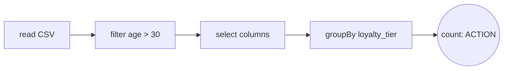

# Practicing Spark Basics in Databricks (Part 1)

In this lesson, we’ll explore how to get started with **Apache Spark** in **Databricks** and practice some of the fundamental Spark operations, such as filtering, transformations, and actions.

---

## Introduction to Databricks

**Databricks** is a unified analytics platform built on top of Apache Spark. It provides an interactive workspace for data engineers, data scientists, and analysts to collaborate on large-scale data processing projects.

### Key Features of Databricks:
1. **Integrated with Spark**: Databricks is built on Spark, making it a powerful tool for running distributed data processing jobs with minimal setup.
2. **Notebooks**: Databricks provides interactive notebooks that allow you to write code, visualize data, and document your analysis in one place.
3. **Collaborative**: Multiple users can collaborate on the same project, making it ideal for team-based data projects.
4. **Scalable**: Databricks is designed to scale out workloads on cloud-based clusters, allowing users to handle large datasets efficiently.

### Setting Up Databricks Free Edition
For this course we use **Databricks Free Edition**, which is free and does not need a credit card. (It replaced the old *Community Edition*, so you may still see that name in older tutorials.)

1. Sign up at [databricks.com/learn/free-edition](https://www.databricks.com/learn/free-edition).
2. In the left menu, click **Workspace**: this is where your notebooks are. You can create a new one with **Create > Notebook**, or import one of the course notebooks (see below).
3. The notebook runs on **serverless compute**: you don't need to create a cluster, just run the first cell.
4. In a Databricks notebook the variable `spark` (the `SparkSession`) already exists, so you can use it directly.

### The Course Notebook: Spark Basics, Compared with pandas
Instead of typing the examples of this lesson, import the notebook [`spark_basics_vs_pandas.ipynb`](../notebooks/spark/spark_basics_vs_pandas.ipynb). It shows every basic operation twice, first in pandas and then in Spark, and loads the data by itself.

1. In Databricks, click **Workspace** in the left menu, open your home folder, and click **Import** (in the menu with the three dots, or by right-clicking the folder).
2. Choose **URL** and paste this link:
   ```
   https://raw.githubusercontent.com/Naviden/Introduction-to-Big-Data-and-NoSQL/main/notebooks/spark/spark_basics_vs_pandas.ipynb
   ```
3. Open the imported notebook and run the cells from top to bottom (**Shift + Enter** runs a cell and moves to the next one).

The other notebooks of the course are imported the same way: use the "raw" link of the file (`raw.githubusercontent.com/...`), not the normal GitHub page.

The rest of this lesson explains the same operations in more detail.

---

## Basic Operations in Spark

Apache Spark is a distributed computing system designed for large-scale data processing. While Spark itself is written in **Scala**, it offers APIs for several languages, including **Python** through **PySpark**. PySpark provides a Pythonic interface to Spark, making it accessible to Python developers.

Below are some basic operations you can perform using PySpark. In the examples we use the retail customers dataset of this repository ([`data/retail/customers.csv`](../data/retail/customers.csv)), which has these columns: `customer_id, first_name, last_name, email, signup_date, age, loyalty_tier, is_student, home_city, home_region`.

---

### 1. **Loading Data into Spark**
The first step in any Spark application is loading data into a **DataFrame**. In PySpark, you can easily load data from various formats such as **CSV**, **Parquet**, or **Delta**.

**Option A: upload the file to a volume.** In Databricks, click **Catalog**, open `workspace > default`, and create a volume (for example `course_data`). Upload the CSV files to the volume, then read them with their path. (If you skip this step you get the error `UC_VOLUME_NOT_FOUND`: the volume does not exist yet.)

```python
# Load a CSV file from a Unity Catalog volume into a DataFrame
df = spark.read.csv("/Volumes/workspace/default/course_data/customers.csv", header=True, inferSchema=True)
```

- `header=True`: Indicates that the first row of the file contains column names.
- `inferSchema=True`: Automatically infers the data types of the columns (otherwise every column is a string).

**Option B: read the file directly from GitHub.** For small files you can let pandas download the CSV and then convert it to a Spark DataFrame. The notebooks of this course use this option, so they work without uploading anything:

```python
import pandas as pd

DATA_URL = "https://raw.githubusercontent.com/Naviden/Introduction-to-Big-Data-and-NoSQL/main/data"

df = spark.createDataFrame(pd.read_csv(f"{DATA_URL}/retail/customers.csv"))
```

This is fine for files of a few MB. For real big data you would never pass through pandas: the data would be read by Spark directly from distributed storage (a volume, S3, HDFS, ...).

Spark DataFrames are similar to Pandas DataFrames but are distributed across a cluster for scalability.

### Spark Core Concepts:
- **RDD (Resilient Distributed Datasets)**:
  - An abstraction for distributed memory. RDDs allow you to perform transformations (e.g., map, filter) and actions (e.g., count, collect) on large datasets.

- **Spark SQL**:
  - A module for working with structured data using SQL queries. DataFrames and SQL use the same engine, so you can choose the one you prefer.

- **Structured Streaming**:
  - The module for processing data that keeps arriving (e.g., from Kafka or from new files in a folder), with the same DataFrame API.

### 2. Filtering Data

You can filter rows in a DataFrame using the `filter` or `where` methods. This allows you to subset the data based on specific conditions.
```python
# Filter customers older than 30
filtered_df = df.filter(df["age"] > 30)
filtered_df.show(5)
```
- `filter` and `where` are equivalent and can be used interchangeably.
- `show()`: Displays the first rows of the DataFrame (20 by default, here 5). In Databricks you can also use `display(df)` to get an interactive table.

You can combine conditions with `&` (and), `|` (or) and `~` (not). Each condition must be inside parentheses:

```python
from pyspark.sql import functions as F

gold_students = df.filter((F.col("loyalty_tier") == "Gold") & (F.col("is_student") == 1))
```

### 3. Transformations in Spark

Transformations in Spark are lazy operations, meaning they define the computation steps but do not execute them immediately. These steps are executed only when an action is triggered.

Common Transformations:

- `select`: Choose specific columns.
- `filter`: Subset rows.
- `groupBy`: Group rows based on column values.
- `withColumn`: Add or modify a column.

Example: Selecting specific columns and applying a filter.
```python
# Select specific columns and filter the data
transformed_df = df.select("first_name", "last_name", "age").filter(df["age"] > 30)
transformed_df.show(5)
```

Example: Adding a new column with `withColumn`.
```python
from pyspark.sql import functions as F

with_full_name = df.withColumn("full_name", F.concat_ws(" ", "first_name", "last_name"))
with_full_name.select("customer_id", "full_name").show(5)
```

### 4. Actions in Spark

Actions in Spark trigger the execution of the transformations. They return results to the driver program or write the results to storage.

Common Actions:
- `show()`: Displays rows in the DataFrame.
- `count()`: Returns the number of rows.
- `collect()`: Retrieves all rows as a list (be cautious with large datasets: all the data is sent to a single machine).

Example:

```python
# Count the number of rows after filtering
row_count = transformed_df.count()
print(f"Number of rows: {row_count}")
```

- `count()` computes the total number of rows that match the specified conditions.
- Actions like `show()` or `count()` force Spark to execute the computation steps defined by the transformations.

## Understanding Lazy Operations in Spark

One of the most important concepts in Spark is **lazy evaluation**. This design principle is crucial for optimizing the execution of large-scale data processing tasks.

---

### What Are Lazy Operations?

In Spark, **Transformations** (like `filter`, `select`, and `groupBy`) are **lazy operations**. This means that when you define a transformation, Spark doesn’t immediately execute it. Instead, it builds a **logical execution plan** (or **DAG** - Directed Acyclic Graph) of all the transformations you’ve defined.



Nothing happens while you define the first four steps. Only when the action at the end is called, Spark looks at the whole graph, optimizes it, and runs it.

**Key Point**: Transformations only define *what* Spark needs to do, not *how* or *when* it will do it.

You can see the plan that Spark builds with `explain()`:

```python
df.filter(df["age"] > 30).select("first_name", "age").explain()
```

---

### Why Is Lazy Evaluation Useful?

1. **Optimization**:
   - Spark waits until an **Action** (e.g., `count()`, `show()`, `collect()`) is called before executing the transformations.
   - During this waiting period, Spark optimizes the entire execution plan to minimize data shuffling, avoid unnecessary computations, and execute tasks efficiently. For example, it can read only the columns you use, or apply a filter as early as possible.

2. **Reduced Overhead**:
   - If multiple transformations are chained together, Spark combines them into a single stage whenever possible. This avoids intermediate steps and reduces the number of passes over the data.

3. **Fault Tolerance**:
   - Spark remembers the chain of transformations that produced each piece of data (its **lineage**). If a node fails, Spark can recompute only the lost partitions from the original data, without re-running the entire workflow.

---

### How Does It Work?

Here’s a simple example to illustrate lazy operations:

```python
# Define a transformation: filtering rows where 'age' > 30
filtered_df = df.filter(df["age"] > 30)

# Define another transformation: selecting specific columns
selected_df = filtered_df.select("first_name", "age")

# At this point, no data is processed yet.
```
When Data Is Actually Processed:
Data is processed only when an action is called, such as:
```python
# Trigger an action
selected_df.show()
```
At this point:
- Spark combines the transformations (filter + select) into a single optimized execution plan.
- The data is processed according to this plan.


#### TLDR

Lazy operations in Spark allow you to define data transformations without immediate execution. This enables Spark to optimize the entire workflow for efficiency, ensuring that computations are executed only when necessary.

---

## Hands-on

- [Spark functions explained with a small salary dataset](../notebooks/spark/salary_analysis_functions.ipynb)
- [Practice: cleaning and aggregating session data](../notebooks/spark/session_data_practice.ipynb)
- [Project: a Spark pipeline on the Airbnb NYC dataset](../notebooks/spark/airbnb_pipeline_project.ipynb)

---

## Practice

Using `data/retail/customers.csv`:

1. How many customers are students? How many of them are in the `Gold` loyalty tier?
2. Add a column `age_group` with the values `"<30"`, `"30-50"` and `">50"` (hint: `F.when`).
3. Which of the following lines are transformations and which are actions? `df.select("age")`, `df.count()`, `df.filter(df.age > 30)`, `df.show()`, `df.groupBy("home_region")`, `df.collect()`.
4. Run `df.filter(df["age"] > 30).select("first_name").explain()` and find the filter in the plan.
