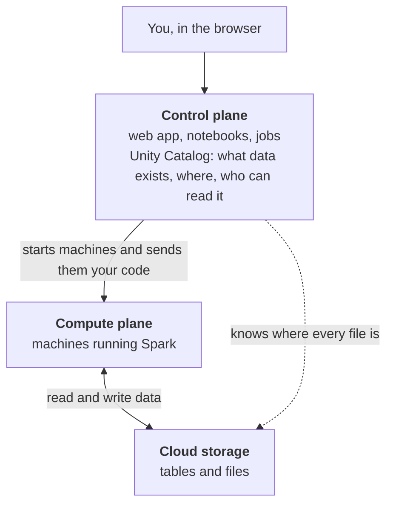
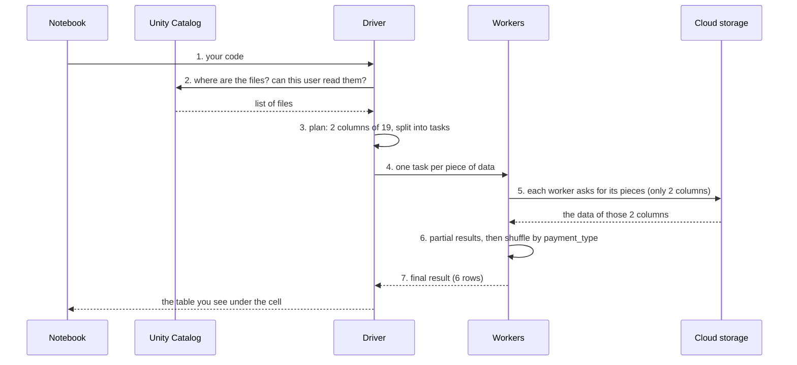

# Inside Databricks: How Storage and Compute Work

In [Lesson 6](06_big_data_technologies.md) we saw how a Hadoop cluster works: the **same machines** store the data (HDFS) and process it (YARN and MapReduce). Databricks, like most modern platforms, is built differently: **storage and compute are separate**.

In this lesson we look inside Databricks: where the data lives, where the code runs, and what happens, step by step, when you run a cell.

---

## 1. The Big Picture: Three Parts

[Databricks](https://docs.databricks.com/aws/en/getting-started/overview) is made of three parts:

- **Control plane**: the "office" of Databricks. It runs the web application you use (notebooks, the Catalog page, scheduled jobs) and [**Unity Catalog**](https://docs.databricks.com/aws/en/data-governance/unity-catalog/), which knows which tables and files exist, where they are stored, and who is allowed to read them. It runs in Databricks' own cloud account.
- **Compute plane**: the machines that run Spark and process the data. They are turned on when there is work to do, and turned off when there is none.
- **Storage**: where the data actually lives, in **cloud object storage** (for example [Amazon S3](https://aws.amazon.com/s3/)). It is always there, even when no machine is running.



---

## 2. Storage: Where the Data Lives

In Databricks the data is **not** stored on the disks of the machines that process it. It is stored in **cloud object storage**: a service of the cloud provider that keeps files safe (in several copies, like HDFS), grows without limits, and is paid by the gigabyte.

Unity Catalog organizes everything with **three-level names**: `catalog.schema.object`. On Databricks Free Edition your catalog is called `workspace` and the default schema is `default`. For example:

| Name | What it is |
|------|------------|
| `workspace.default.taxi_data` | a [**volume**](https://docs.databricks.com/aws/en/volumes/): a folder of plain files (our taxi Parquet files) |
| `workspace.default.urban_orders` | a [**managed table**](https://docs.databricks.com/aws/en/tables/managed): a Delta table (Parquet files plus a transaction log), whose files Databricks places and manages for you |

You never choose on which disk a file goes: you use its name, and Unity Catalog knows where its files are.

> [!IMPORTANT]
> In Databricks the data does not live on the cluster. **Machines come and go; the data stays in cloud storage.** If all the compute is turned off over the weekend, no data is lost.

---

## 3. Compute: Where the Code Runs

When you run a cell, the work is done by a **cluster** of machines with two roles, the same idea as the master and the workers of Lesson 6 ([Spark cluster overview](https://spark.apache.org/docs/latest/cluster-overview.html)):

- **Driver**: the coordinator. It receives your code, makes the plan, splits the work into **tasks**, sends them to the workers and collects the results.
- **Workers**: they run the tasks. Each worker processes its own pieces of the data, in parallel with the others.

Databricks offers several kinds of [compute](https://docs.databricks.com/aws/en/compute/):

- **Classic clusters**: you choose the type and number of machines. They can grow and shrink with the work (*autoscaling*) and turn themselves off after some minutes without work (*auto-termination*), so you do not pay for idle machines.
- [**Serverless compute**](https://docs.databricks.com/aws/en/compute/serverless/): Databricks chooses and manages the machines for you. They start in seconds and scale automatically. **This is the only kind of compute in Databricks Free Edition**: that is why you never had to create a cluster in this course.

On serverless compute Databricks also uses [**Photon**](https://docs.databricks.com/aws/en/compute/photon), a faster engine written in C++. You write normal Spark code; Photon runs it faster.

---

## 4. What Happens When You Run a Cell

Let's follow the tip question of the [Spark at scale notebook](../notebooks/scale/spark_at_scale.ipynb), the average tip by payment type on the whole year of taxi trips:

```python
trips.groupBy("payment_type").agg(F.avg("tip_amount")).show()
```



1. The notebook sends your code to the **driver**.
2. The driver asks **Unity Catalog** where the files are, and checks that you are allowed to read them.
3. The driver makes the **plan**: only `payment_type` and `tip_amount` are needed, and the files are split into pieces (by default up to 128 MB each, like the blocks of HDFS). Each piece becomes a **task**.
4. The tasks are sent to the **workers**.
5. Each worker reads **its own pieces** directly from cloud storage, and only the 2 columns it needs.
6. Each worker computes a partial result for its pieces. Then the **shuffle** sends all the values of the same `payment_type` to the same worker, which combines them (the map, shuffle and reduce of Lesson 6).
7. Only the final result, 6 small rows, travels back to the driver and to your notebook.

---

## 5. Hadoop vs Databricks

| | Hadoop cluster | Databricks |
|---|---|---|
| **Where the data lives** | on the disks of the cluster machines (HDFS) | in cloud object storage |
| **Who knows where the data is** | the NameNode | Unity Catalog (and the storage service itself) |
| **Who runs the work** | YARN and MapReduce, on the same machines | Spark (with Photon), on separate machines |
| **Bigger data** | buy more machines: more storage *and* more compute, together | storage and compute grow separately |
| **When nobody is working** | the machines keep running, because they hold the data | compute is turned off; the data stays in storage |
| **Two teams, same data** | they share the same cluster | each team can use its own compute on the same data |

There is a trade-off. In Hadoop the code went to the machine that held the data on its own disk. In Databricks the workers read the data **over the network** from cloud storage. This works well because cloud networks are fast, because Parquet lets Spark read only the columns it needs, and because workers keep recently read data on their local disks ([disk cache](https://docs.databricks.com/aws/en/optimizations/disk-cache)) so that the next query is faster.

---

## 6. Explore It Yourself

In your Databricks workspace (after running the [Spark at scale notebook](../notebooks/scale/spark_at_scale.ipynb)):

1. **Storage**: click **Catalog** in the left menu and open `workspace > default`. Find the volume `taxi_data` and the Parquet files inside it. These files are in cloud storage, not on a machine.
2. **Compute**: click **Compute** in the left menu. On Free Edition you cannot create your own clusters: your notebooks run on serverless compute, managed by Databricks.
3. **Tasks and data read**: run the tip question of the notebook again and click **See performance** under the cell. Look at the *rows read* and *bytes read*, and compare the bytes read with the 661 MB of the whole year.

---

## Practice

1. A company turns off all its Databricks compute every Friday evening and turns it on again on Monday. What happens to the data? Would the same be possible with a Hadoop cluster?
2. Which part of Databricks plays the role of the **NameNode** of Lesson 6? And of the **DataNodes**?
3. In the tip question, which steps run on the **driver** and which on the **workers**?
4. Two teams want to analyze the same data at the same time, one with heavy machine learning jobs and one with small SQL queries. Why is this easier in Databricks than in a Hadoop cluster?
5. Hadoop sends the code to the machine that has the data on its disk; Databricks workers read the data over the network. Why is this not a big problem in practice?

---

#### TLDR
Databricks has three parts: the **control plane** (web app and Unity Catalog), the **compute plane** (machines running Spark: a driver and workers) and **cloud storage** (the data). Unlike Hadoop, storage and compute are **separate**: the data always stays in storage, and machines are turned on only when there is work to do.
